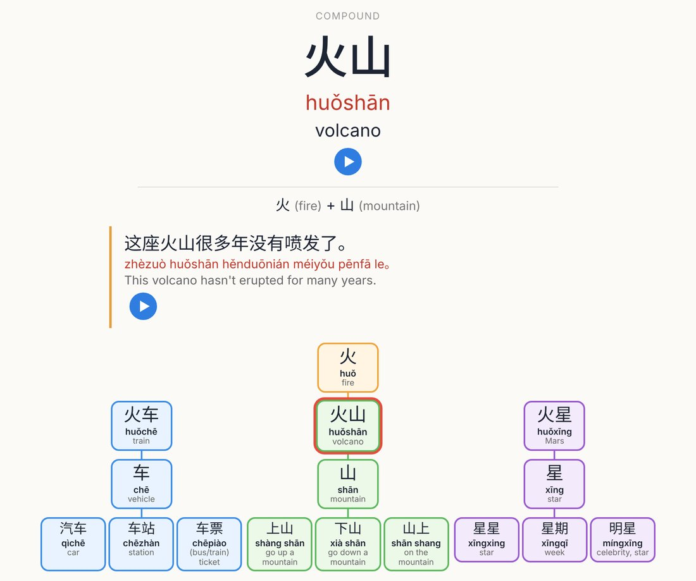
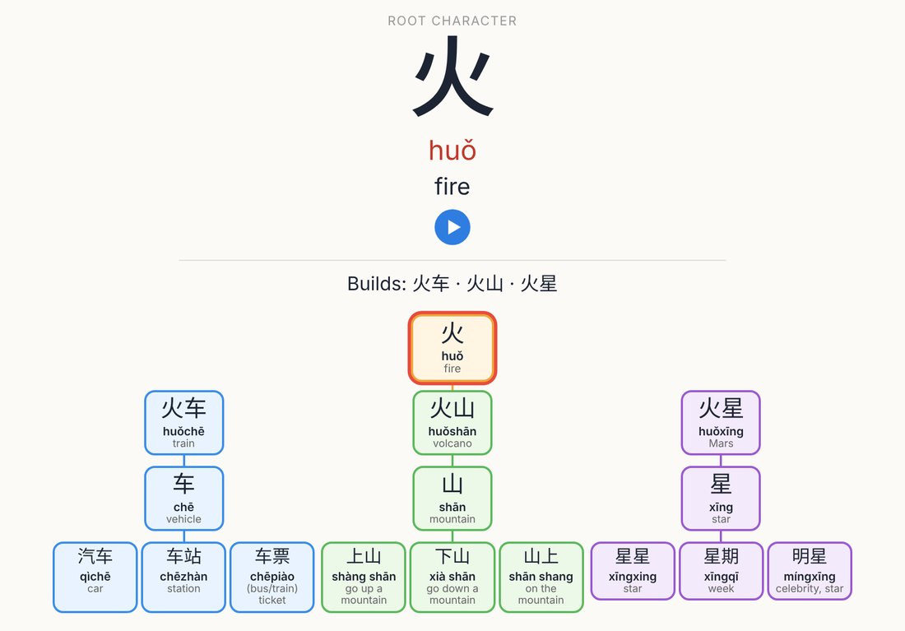
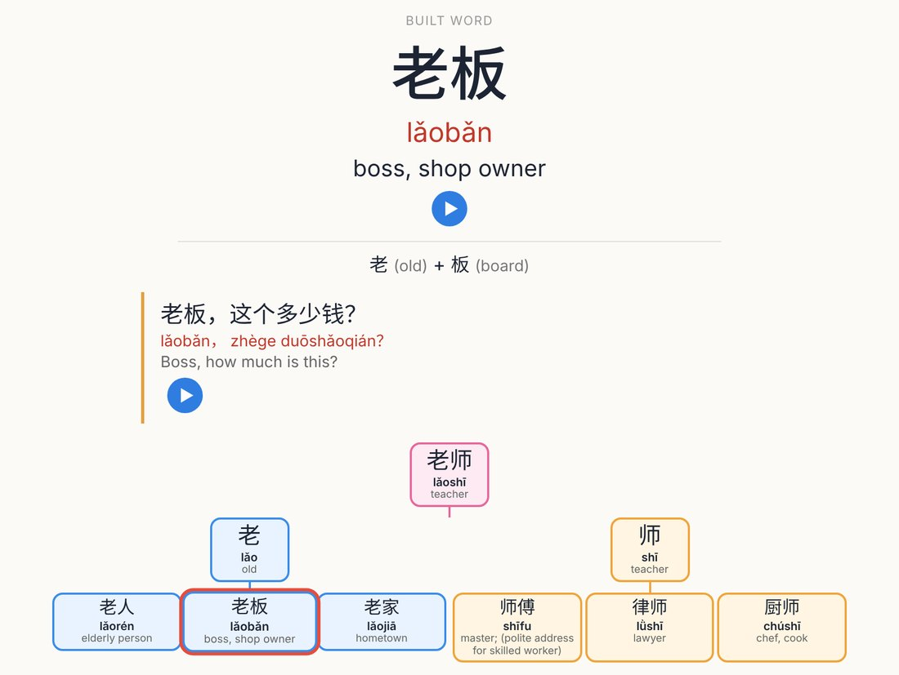
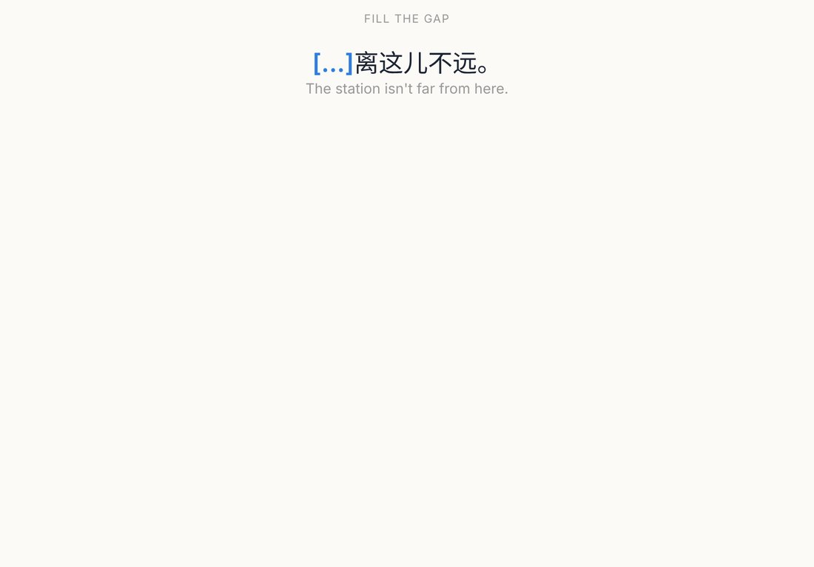
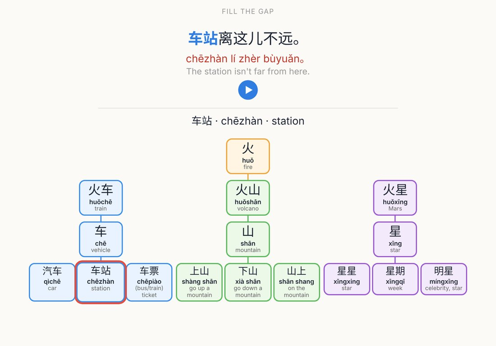
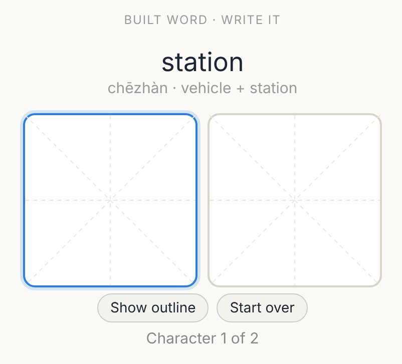
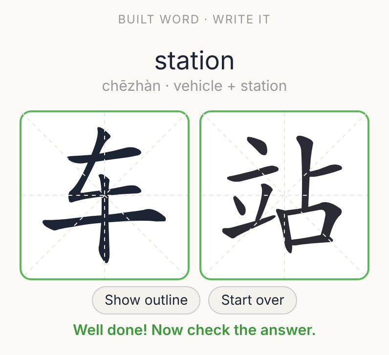
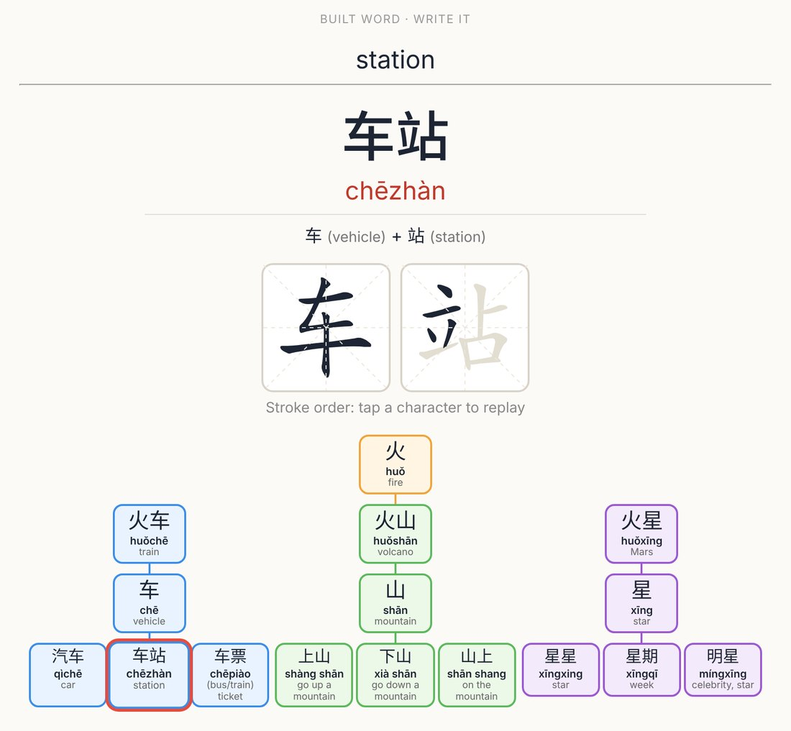
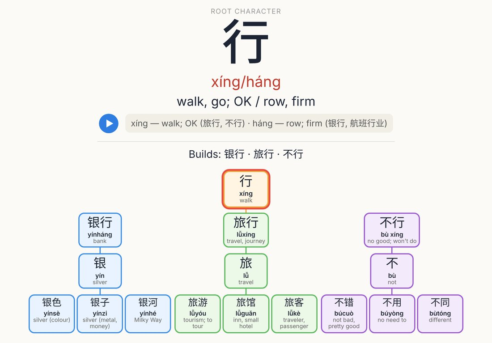

# Chinese Hanzi Trees: an Anki deck

Learn Chinese through **word families**. One character opens a set of words, and each word brings in the next character. Every card shows its own tree, so you can see where a character or word sits, what it's made of and what it connects to.

**Get the deck on AnkiWeb:** https://ankiweb.net/shared/info/916501166



## The trees

- **Root trees (31):** a root character branches into 3 compounds. Each compound brings in a new character, and each new character branches into 3 everyday words.
  火 → 火车 → 车 → 汽车 · 车站 · 车票
- **Split trees (8):** a common word splits into its two characters, and each character branches into 3 words.
  你好 → 你 (你们 · 你的 · 你家) + 好 (好吃 · 好看 · 好朋友)

136 characters · 423 words · 1,828 cards · **stroke pad for writing practice** · animated stroke order · Mandarin audio · example sentences with pinyin and English · cloze cards · characters with more than one reading.

| | |
|---|---|
|  |  |
|  |  |
|  |  |
|  |  |

## Found a mistake?

Please [open an issue](../../issues) with the word or sentence and the fix. Pinyin and tone corrections are especially welcome.

## Building it yourself

```bash
pip install genanki gTTS pypinyin jieba
cd src
npm install --prefix hw hanzi-writer@3.7.2 hanzi-writer-data@2.0.1
cp hw/node_modules/hanzi-writer/dist/hanzi-writer.min.js _hanzi-writer.min.js
python audio.py    # generates Mandarin TTS for every character, word and sentence
python build.py    # writes Chinese_Hanzi_Trees.apkg
```

The vocabulary, sentences and character glosses all live in `src/data.py`. To add a tree, append to `TREES` (root trees) or `SPLITS` (split trees) and rebuild. Note IDs are stable, so re-importing updates existing cards without losing review history.

## Credits & licenses

- Writing pad: [Hanzi Writer](https://hanziwriter.org) by David Chanin (MIT).
- Stroke data: [Make Me a Hanzi](https://github.com/skishore/makemeahanzi), derived from Arphic fonts and distributed under the Arphic Public License. See .
- Audio: computer-generated Mandarin text-to-speech.
