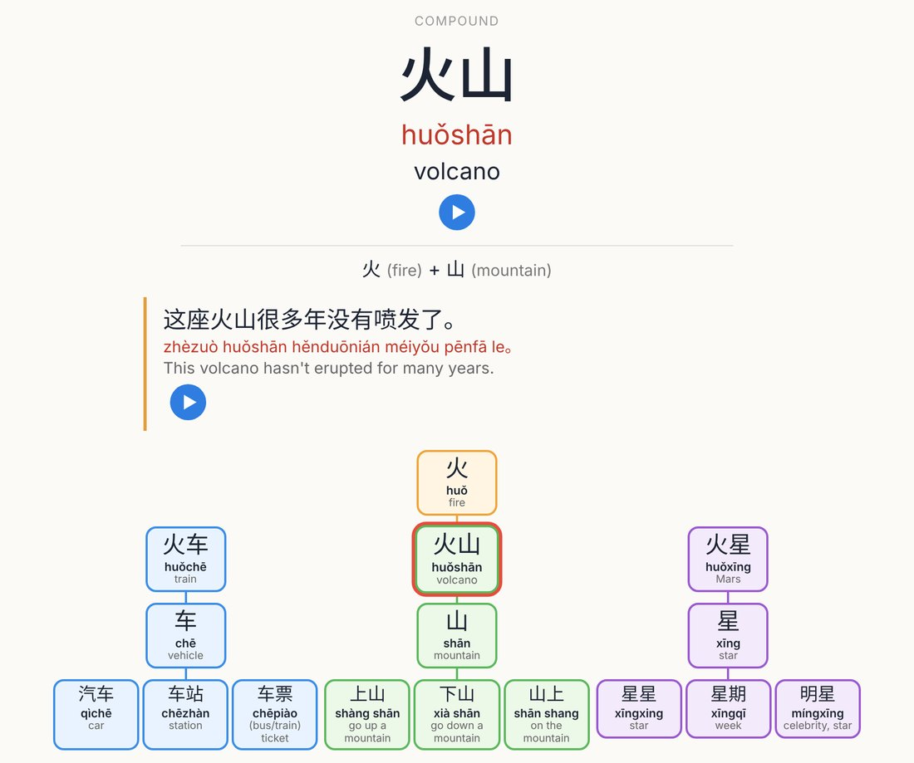
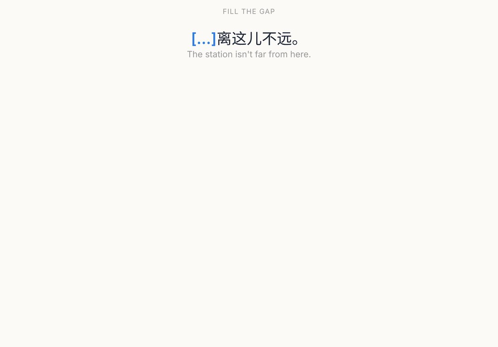
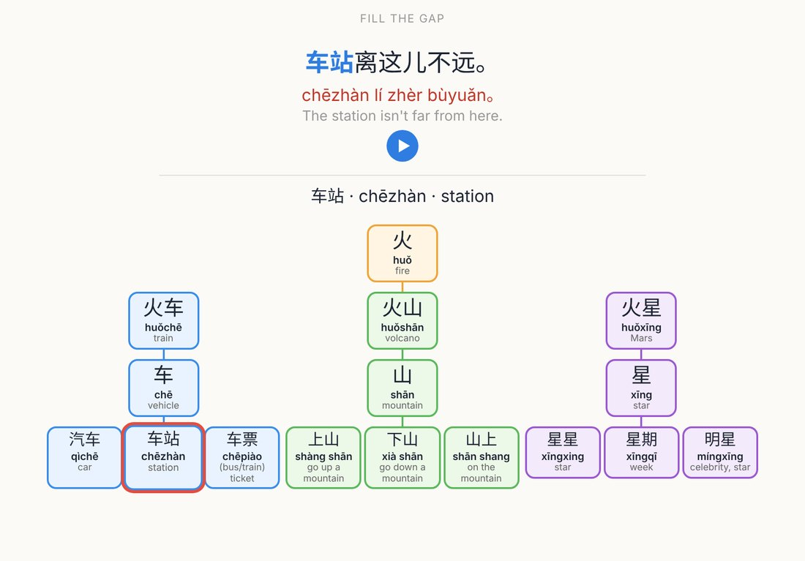
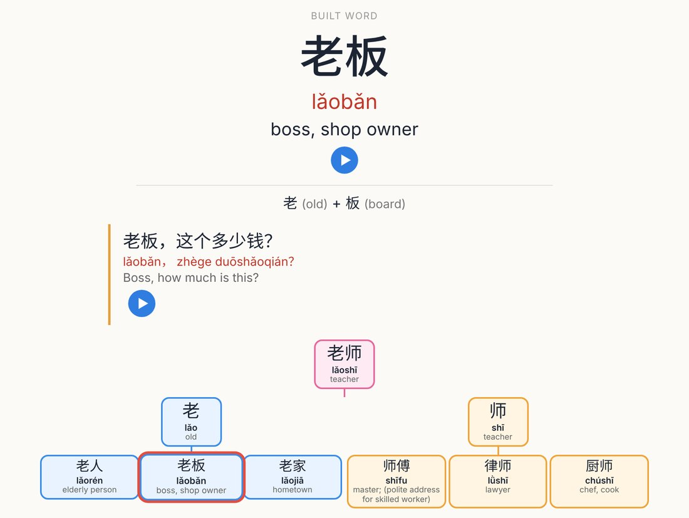
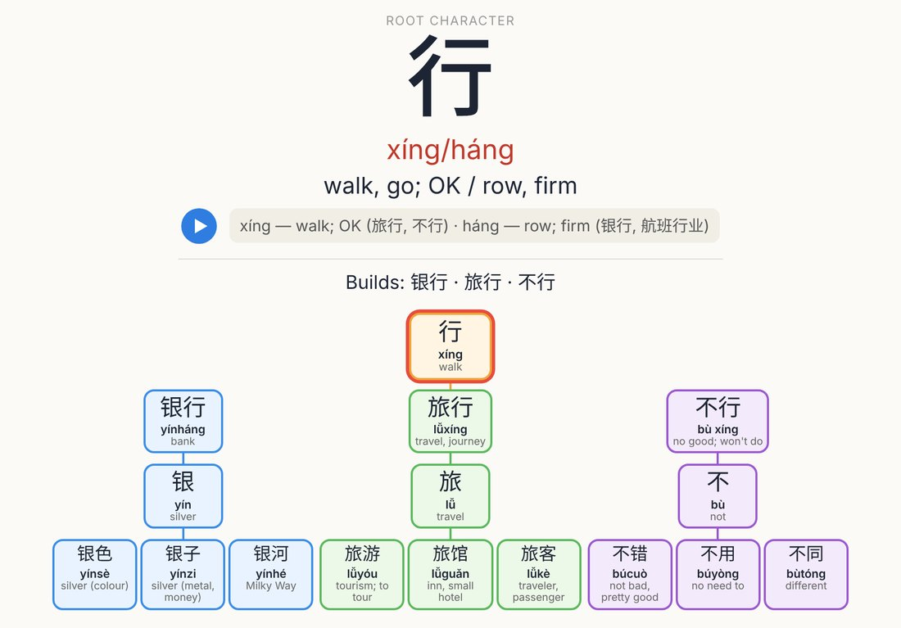

**Learn Chinese the way it's actually built: one character opens a family of words, and each word brings in the next character.**

Every card shows its own *Hanzi tree*, so you can see where a character or word sits, what it's made of and what it connects to. Instead of 400 unrelated flashcards, you learn 39 small, connected families.

## How the trees work

**Root trees (31).** A root character branches into three compounds. Each compound brings in a new character, and each new character branches into three everyday words.

> 火 fire → 火车 train → 车 vehicle → 汽车 car · 车站 station · 车票 ticket

**Split trees (8).** A common word splits into its two characters, and each character branches into three words.

> 你好 hello → 你 (你们 · 你的 · 你家) + 好 (好吃 · 好看 · 好朋友)

Root characters: 火 人 水 日 月 大 天 手 中 上 吃 看 说 钱 木 白 门 爱 时 行 东 女 子 路 雨 身 力 公 花 海 瓜

## What's inside

- **136 characters, 423 words, 1,828 cards**
- **39 subdecks**, one per tree, each with a description listing its branches
- **Mandarin audio** for every character, word and example sentence
- **An example sentence for every word**, with full pinyin and English
- **Characters with more than one reading** show all of them, with examples (行 xíng / háng, 好 hǎo / hào, 乐 lè / yuè, 觉 jué / jiào…)
- **A "+" breakdown on every word**: 车站 = 车 (vehicle) + 站 (station)

## Card types

1. **Character**: see the character, recall its sound and meaning
2. **Read**: see the word, recall its pinyin and meaning, then see the example sentence and tree
3. **Recall**: see the English and the character hints, write the word
4. **Listen**: hear the word, name it
5. **Cloze**: fill the missing word into a real sentence

Cards come in tree order: root, compound, linked character, then the words built on it. Each card builds on the one before.

## Tips

- About 1,800 cards is a lot. To lighten the load, suspend `card:Listen*` or `card:Recall*` in the Browser and turn them back on later.
- Every note is tagged by tree (`tree_火`, `split_你好`…) and by type (`character`, `word`, `cloze`).
- Works in light and dark mode and on phones.

## Level & notes

Beginner to lower-intermediate: mostly HSK 1–3, with some HSK 4. Simplified characters, tone-mark pinyin.

Word pinyin was checked by hand. Sentence pinyin was generated, then corrected for tone sandhi (一, 不, 3rd-tone pairs) and common neutral tones. If you spot a mistake, please leave a comment and it'll be fixed in the next update.

Audio is computer-generated Mandarin text-to-speech.

---

Source, screenshots and issue tracker: [github.com/aamanlamba/hanzi-trees](https://github.com/aamanlamba/hanzi-trees)
